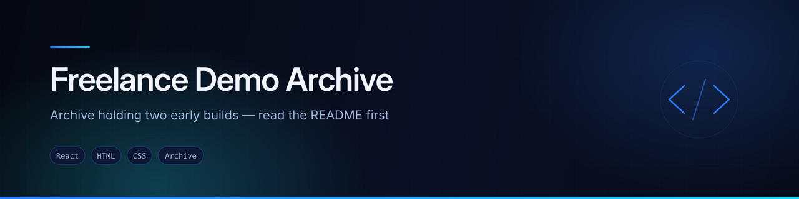
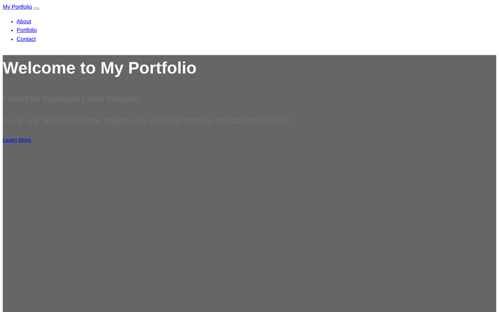

<div align="center">
  
</div>

<div align="center">


</div>

## What this repository actually is

**An archive, not a project.** It holds two unrelated builds that were committed into one repository, and the folder names do not describe either of them.

Reading this before you open it will save you some confusion:

| Folder | What is actually in it |
|---|---|
| `india/india/` | A copy of the **Scamsters** prototype — the scam-reporting platform. Same 15 routes, same components, same seeded data as [`scamsters-prototype`](https://github.com/AJAY2043/scamsters-prototype). |
| `projects by AR/` | A small **static portfolio page** — one `index.html`, one `styles.css`, four lines of JavaScript. Unrelated to the folder above. |

The previous README read `"# shopper-react"` and `"# shopper"` — the name of a different repository again. None of the three names matched the contents.

## Preview



<sub>Screenshot of `projects by AR/index.html`, captured in a browser. The `india/india/` folder is covered by the [`scamsters-prototype`](https://github.com/AJAY2043/scamsters-prototype) repository, which is the maintained copy.</sub>

## `projects by AR/` — static portfolio page

A single-page front-end developer portfolio: About, Portfolio and Contact sections with smooth scrolling.

```
projects by AR/
├── index.html     142 lines — every section
├── styles.css     85 lines
└── script.js      4 lines — smooth scrolling
```

To view it:

```bash
cd "projects by AR"
npx http-server -p 8080
```

## `india/india/` — Scamsters copy

A Create React App copy of the Scamsters prototype, nested two folders deep. **Use [`scamsters-prototype`](https://github.com/AJAY2043/scamsters-prototype) instead** — it is the maintained version, with documentation and a recorded build fix.

If you do need to run this copy:

```bash
cd india/india
npm install
npm install @fortawesome/fontawesome-svg-core    # missing peer dependency
npm start
```

## Recommended clean-up

Nothing here is deleted or moved by this README — that is the owner's call. The sensible tidy-up, in order:

1. **Rename the repository** to describe what is kept, or archive it
2. **Drop the `india/india/` copy**, since `scamsters-prototype` supersedes it
3. **Flatten `projects by AR/`** to the repository root, or move it into a portfolio repository
4. **Rename the folder** — a space in a directory name causes quoting problems in every shell command that touches it

Until then, this README is the map.

## Author

**Ajay Krishna Reddy Bhavanam** — Melbourne, Australia
[LinkedIn](https://linkedin.com/in/ajay-krishna-reddy) · [GitHub](https://github.com/AJAY2043)
